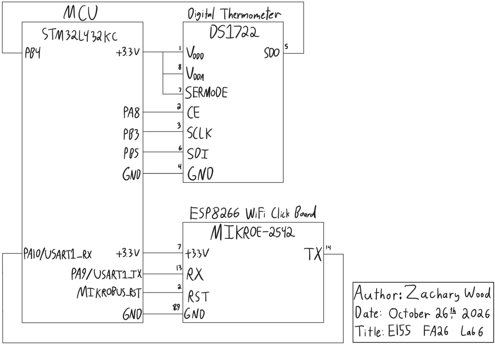

## Introduction

The goal of this lab was to build an internet-accessible temperature sensor with the STM32L432KC. The MCU reads a DS1722 digital thermometer over SPI with a driver written from the reference manual using the CMSIS device templates, and it serves a webpage through an ESP8266 WiFi module over UART. From the webpage, a user can view the current temperature, turn an LED on and off, and set the sensor's resolution from 8 to 12 bits.

## Design and Testing Methodology

### MCU Implementation

The design builds on the flash, GPIO, RCC, and USART libraries from the course's [ESP8266 web server tutorial](https://github.com/HMC-E155/tutorial-esp8266-click-webserver) and from  previous labs. `configureClock()` sets an 80 MHz system clock from the PLL, and the APB2 prescaler is left at its reset value of 1, so SPI1, which is on APB2, is also clocked at 80 MHz.

I wrote a new library, `STM32L432KC_SPI`, from the SPI chapter of RM0394 (Sections 40.4.7, 40.4.9, and 40.6), using the register structs and bit macros from the CMSIS device header `stm32l432xx.h`:

| Function | Operation |
|---|---|
| `initSPI(br, cpol, cpha)` | Routes SPI1 to PB3 (SCK), PB4 (MISO), and PB5 (MOSI), enables its clock, configures it as a master with the given baud rate divider, clock polarity, and clock phase, and then enables it |
| `spiSendReceive(send)` | Writes one byte to the data register, waits for the received byte, and then returns it |

`initSPI()` selects alternate function 5 on all three pins, which DS11451 Table 15 assigns to SPI1. In SPI_CR1, it writes BR, CPOL, and CPHA from its arguments and sets MSTR, SSM, and SSI, leaving BIDIMODE, CRCEN, and LSBFIRST at 0 for full-duplex, MSB-first transfers without using CRC. CE is active high while the SPI's hardware NSS output is active low, so CE is driven as a GPIO pin instead, and software slave management with SSI = 1 holds the internal NSS high so the master does not raise a mode fault. In SPI_CR2, DS = 0111 selects 8-bit frames, and FRXTH = 1 sets RXNE when one byte, rather than two, is in the receive FIFO.

`spiSendReceive()` waits for TXE, writes the byte, then waits for RXNE and reads the received byte. Every byte sent returns one byte so the receive FIFO is empty after each call.

`main.h` sets BR = 100 (divide by 32), CPOL = 0, and CPHA = 1. The DS1722 requires CPHA = 1 (note to Table 6 of the DS1722 datasheet), and it determines the clock polarity by sampling SCLK when CE rises, so either CPOL would work.

I also wrote a `DS1722` library from the DS1722 datasheet. Its header defines the register addresses from Table 4 and the configuration register's bit positions and masks from Figure 2, which I named using the `_Pos` and `_Msk` style of the CMSIS header. Each register access is one transaction with CE high: the address byte, followed by either the data byte for a write or a dummy 00h byte for a read, during which the DS1722 shifts out the register's contents (Figures 4 and 5).

| Function | Operation |
|---|---|
| `initDS1722()` | Configures the CE pin as a GPIO output, drives it low, and then writes E0h to the configuration register |
| `readTemperature()` | Reads the temperature MSB (02h) and LSB (01h) and returns the temperature in degrees Celsius |
| `setResolution(bits)` | Writes the configuration register with R2:R0 = bits - 8, for 8 to 12 bits |
| `getResolution()` | Reads the configuration register and returns its resolution in bits |

The DS1722 powers up in shutdown mode (SD = 1), so `initDS1722()` must clear SD to start continuous conversions. E0h sets the three fixed upper bits, selects 8-bit resolution, and clears 1SHOT and SD.

`lab6_zw.c` follows the structure of the starter code's main program. The main loop waits for a newline-terminated request from the ESP8266 on USART1 at 125000 baud and searches it with `strstr()` for the tags `ledon` and `ledoff`, which set the LED on PA6 with `digitalWrite()`, and `res8` through `res12`, which call `setResolution()`. It then reads the temperature and resolution from the sensor and sends the page: a form button for each LED state and each resolution, the LED state, and the temperature with its resolution. The resolution on the page comes from `getResolution()`, which reads the configuration register back, so the page shows the sensor's actual setting rather than the last request. The temperature is printed with four decimal places to match the 0.0625 °C step at 12 bits.

### Testing

<!-- TODO: check CE, SCLK, and SDI on the logic analyzer with the sensor disconnected, then connect the DS1722 and check SDO. Check room temperature and temperature holding the sensor between my fingers. Already checked LED functionality.  -->

## Technical Documentation

The source code for the project can be found in the associated [Github repository](https://github.com/wood-zachary/hmc-e155-portfolio/tree/main/labs/lab6).

### Schematic

Figure 1 shows the schematic of the physical circuit. On-board components, including the Nucleo-L432KC, are documented in the [development board schematic](https://hmc-e155.github.io/assets/doc/E155%20Development%20Board%20Schematic.pdf).



The DS1722 requires no external components. Its digital supply VDDD (1.8 V to 5.5 V) and analog supply VDDA (2.65 V to 5.5 V) are both tied to 3.3 V, as well as SERMODE, which makes the chip select the SPI interface. Tying it to ground would instead select the 3-wire interface. CE is driven by PA8 as a GPIO output, and SCLK, SDI, and SDO connect to SPI1's SCK (PB3), MOSI (PB5), and MISO (PB4), respectively.

<!-- TODO: maybe fix DS1722_CE declaration. -->

The ESP8266 click board plugs into the development board's mikroBUS socket (U5). The socket routes its TX and RX pins to USART1 on PA9 and PA10, respectively, and the socket's TX and RX labels name the MCU's side of each line, so the click board receives on the socket's TX pin and transmits on its RX pin. The click's reset pin connects to the socket's RST pin, which jumper J2 selects between a 10 kΩ pull-up to 3.3 V (R3, pins 1-2) and PA12 (pins 2-3). J2 is set to pins 1-2, which holds the reset line high so the ESP8266 runs whenever it is powered.

The LED is the development board's D4, driven by PA6 through its 1 kΩ series resistor R7. The MCU/FPGA DIP switch SW7 is set open, which disconnects PA10, PA9, PA5, PA6, PA11, PB5, PB4, and PB3 from the FPGA.

#### Calculations

**SPI clock.** SPI1 is clocked by PCLK2 at 80 MHz, and BR = 100 selects a divider of $2^{BR+1} = 32$, so

$$f_{SCK} = \frac{80\text{ MHz}}{32} = 2.5\text{ MHz}$$

which is below the DS1722's 5.0 MHz maximum. Each half period lasts 200 ns, twice the 100 ns minimum SCLK high and low times. A two-byte register access takes 16 clock periods, or $6.4\ \mu\text{s}$.

**Resolution.** From Table 5 of DS1722:

| Resolution | R2:R0 | Configuration byte | Step | Max conversion time |
|---|---|---|---|---|
| 8 bits | 000 | E0h | 1.0 °C | 75 ms |
| 9 bits | 001 | E2h | 0.5 °C | 150 ms |
| 10 bits | 010 | E4h | 0.25 °C | 300 ms |
| 11 bits | 011 | E6h | 0.125 °C | 600 ms |
| 12 bits | 100 | E8h | 0.0625 °C | 1.2 s |

**Temperature range.** The temperature register holds a 16-bit two's complement value $N = \{\text{MSB}, \text{LSB}\}$ with the integer part in the MSB and the fraction in the upper bits of the LSB (Table 3), and

$$T = \frac{N}{256}\ ^\circ\text{C}$$

For example, Table 3 lists -10.125 °C as F5E0h, which is $-2592$ as a signed 16-bit value, and $-2592 / 256 = -10.125$. The ends of the required range are -10 °C, or F600h ($N = -2560$), and 30 °C, or 1E00h ($N = 7680$). A signed 16-bit value spans -128 °C to 127.996 °C, which covers the sensor's full -55 °C to +120 °C range at every resolution, since lower resolutions only clear the low bits of the LSB. `readTemperature()` stores the word in an `int16_t`, so the sign bit S becomes the sign of the result and negative temperatures convert correctly.

### Logic Analyzer Capture

Signals are named from the DS1722's side: SDI is the MCU's MOSI (PB5), and SDO is its MISO (PB4). During a read, the MCU sends the register address on SDI while SDO stays high impedance, then sends 00h while the DS1722 shifts the register's contents out on SDO.

<!-- TODO: add the capture. -->

The table below compares the timing in Figure 2 with the DS1722's AC electrical characteristics for the SPI interface.

| Parameter | Symbol | DS1722 requirement | Measured |
|---|---|---|---|
| SCLK frequency | $t_{CLK}$ | 5.0 MHz max | |
| SCLK high and low time | $t_{CH}$, $t_{CL}$ | 100 ns min | |
| CE to SCLK setup | $t_{CC}$ | 400 ns min | |
| SCLK to CE hold | $t_{CCH}$ | 100 ns min | |
| CE inactive time | $t_{CWH}$ | 400 ns min | |

## Results and Discussion

<!-- TODO -->

## Conclusion

The design reads a DS1722 temperature sensor over SPI with a CMSIS-based driver and serves the temperature, an LED control, and a resolution control on a webpage through an ESP8266.

<!-- TODO: how the design performed. -->

::: {.callout-note collapse="true"}
## Hours spent (click to expand)
<!-- TODO: total hours and breakdown. -->
:::

## AI Prototype Summary

The purpose of this AI prototype is to test whether an LLM writes better frontend web code than low-level embedded C. I ran each prompt in a separate incognito session.

::: {.callout-tip collapse="true"}
## Prompt 1 (Claude Opus 5.5, incognito, medium effort)
I'm making a web portal to interface with a temperature sensor. Create a HTML page that looks good and is intuitive to show the temperature, control an LED, and change the precision of the readout.
:::

The LLM returned a single HTML file with inline CSS and JavaScript and no external dependencies. It assumed that the device serves a JSON API from the same origin as the page, with `GET /api/temperature`, `GET /api/led`, and `PUT /api/led`, and the page polls the temperature once per second. It interpreted "precision" as the number of decimal places shown, from 0 to 3. It noted that this setting does not change the sensor's resolution and suggested adding a `PUT /api/resolution`. Opening it with `?demo` replaces the device with a simulated sensor and LED. In its integration notes, it said that the page must be served by the device, that an API on a different origin would need CORS headers, and that polling suits small HTTP servers.

::: {.callout-tip collapse="true"}
## Generated webpage
```html
<!DOCTYPE html>
<html lang="en">
<head>
<meta charset="utf-8">
<meta name="viewport" content="width=device-width, initial-scale=1">
<title>Temperature Sensor Portal</title>
<style>
    :root {
        --bg: #0f172a;
        --card: #1e293b;
        --border: #334155;
        --text: #e2e8f0;
        --muted: #94a3b8;
        --accent: #38bdf8;
        --accent-contrast: #0f172a;
        --ok: #22c55e;
        --err: #ef4444;
        --pending: #f59e0b;
        --track-off: #475569;
        --led-off: #3f3f46;
        --led-on: #facc15;
        --radius: 14px;
    }

    @media (prefers-color-scheme: light) {
        :root {
            --bg: #f1f5f9;
            --card: #ffffff;
            --border: #cbd5e1;
            --text: #0f172a;
            --muted: #64748b;
            --accent: #0284c7;
            --accent-contrast: #ffffff;
            --track-off: #cbd5e1;
            --led-off: #d4d4d8;
        }
    }

    *, *::before, *::after {
        box-sizing: border-box;
    }

    body {
        margin: 0;
        min-height: 100vh;
        background: var(--bg);
        color: var(--text);
        font-family: system-ui, -apple-system, "Segoe UI", Roboto, sans-serif;
        line-height: 1.4;
    }

    /* ---- Header ---- */

    .topbar {
        display: flex;
        align-items: center;
        justify-content: space-between;
        gap: 12px;
        max-width: 880px;
        margin: 0 auto;
        padding: 24px 16px 8px;
    }

    .topbar h1 {
        margin: 0;
        font-size: 1.4rem;
        font-weight: 650;
    }

    .topbar__badges {
        display: flex;
        gap: 8px;
    }

    .pill {
        display: inline-flex;
        align-items: center;
        gap: 6px;
        padding: 4px 12px;
        border: 1px solid var(--border);
        border-radius: 999px;
        font-size: 0.85rem;
        color: var(--muted);
    }

    .pill::before {
        content: "";
        width: 8px;
        height: 8px;
        border-radius: 50%;
        background: currentColor;
    }

    .pill--live { color: var(--ok); }
    .pill--offline { color: var(--err); }
    .pill--connecting { color: var(--pending); }

    /* ---- Layout ---- */

    .grid {
        display: grid;
        grid-template-columns: repeat(2, minmax(0, 1fr));
        gap: 16px;
        max-width: 880px;
        margin: 0 auto;
        padding: 16px;
    }

    .card {
        background: var(--card);
        border: 1px solid var(--border);
        border-radius: var(--radius);
        padding: 20px;
    }

    .card--temp {
        grid-column: 1 / -1;
    }

    .card h2 {
        margin: 0 0 12px;
        font-size: 0.8rem;
        font-weight: 600;
        letter-spacing: 0.06em;
        text-transform: uppercase;
        color: var(--muted);
    }

    .muted {
        margin: 12px 0 0;
        color: var(--muted);
        font-size: 0.9rem;
    }

    @media (max-width: 600px) {
        .grid {
            grid-template-columns: 1fr;
        }
    }

    /* ---- Temperature readout ---- */

    .readout {
        margin: 0;
        font-size: clamp(3.5rem, 12vw, 6rem);
        font-weight: 300;
        line-height: 1;
        font-variant-numeric: tabular-nums;
        transition: opacity 200ms;
    }

    .readout .unit {
        margin-left: 4px;
        font-size: 0.4em;
        color: var(--muted);
        vertical-align: super;
    }

    .readout--stale {
        opacity: 0.4;
    }

    .stats {
        display: flex;
        flex-wrap: wrap;
        gap: 24px;
        margin: 16px 0 0;
    }

    .stats dt {
        font-size: 0.8rem;
        color: var(--muted);
    }

    .stats dd {
        margin: 0;
        font-variant-numeric: tabular-nums;
    }

    .sparkline {
        display: block;
        width: 100%;
        height: 80px;
        margin-top: 16px;
    }

    /* ---- LED control ---- */

    .led-row {
        display: flex;
        align-items: center;
        justify-content: space-between;
    }

    .led {
        width: 40px;
        height: 40px;
        border-radius: 50%;
        border: 2px solid var(--border);
        background: var(--led-off);
        transition: background 150ms, box-shadow 150ms;
    }

    .led--on {
        background: var(--led-on);
        box-shadow: 0 0 18px 6px rgba(250, 204, 21, 0.55);
    }

    .switch {
        position: relative;
        width: 56px;
        height: 32px;
        padding: 0;
        border: 1px solid var(--border);
        border-radius: 16px;
        background: var(--track-off);
        cursor: pointer;
        transition: background 150ms;
    }

    .switch[aria-checked="true"] {
        background: var(--ok);
    }

    .switch:disabled {
        opacity: 0.5;
        cursor: progress;
    }

    .switch:focus-visible {
        outline: 2px solid var(--accent);
        outline-offset: 3px;
    }

    /* Thumb travel = inner width (54) - thumb (24) - 2 x inset (2) = 26 px. */
    .switch__thumb {
        position: absolute;
        top: 2px;
        left: 2px;
        width: 26px;
        height: 26px;
        border-radius: 50%;
        background: #ffffff;
        box-shadow: 0 1px 3px rgba(0, 0, 0, 0.3);
        transition: transform 150ms;
    }

    .switch[aria-checked="true"] .switch__thumb {
        transform: translateX(24px);
    }

    /* ---- Precision selector ---- */

    .segmented {
        display: flex;
        gap: 4px;
        margin: 0;
        padding: 4px;
        border: 1px solid var(--border);
        border-radius: 10px;
    }

    .segmented label {
        position: relative;
        flex: 1;
    }

    .segmented input {
        position: absolute;
        inset: 0;
        margin: 0;
        opacity: 0;
        cursor: pointer;
    }

    .segmented span {
        display: block;
        padding: 8px 0;
        border-radius: 6px;
        text-align: center;
        font-variant-numeric: tabular-nums;
        transition: background 150ms;
    }

    .segmented input:checked + span {
        background: var(--accent);
        color: var(--accent-contrast);
        font-weight: 600;
    }

    .segmented input:focus-visible + span {
        outline: 2px solid var(--accent);
        outline-offset: 2px;
    }

    .visually-hidden {
        position: absolute;
        width: 1px;
        height: 1px;
        overflow: hidden;
        clip: rect(0 0 0 0);
        white-space: nowrap;
    }

    /* ---- Notifications ---- */

    .toast {
        position: fixed;
        left: 50%;
        bottom: 24px;
        margin: 0;
        padding: 10px 16px;
        border-radius: 10px;
        background: var(--err);
        color: #ffffff;
        transform: translate(-50%, 200%);
        transition: transform 200ms;
    }

    .toast--visible {
        transform: translate(-50%, 0);
    }
</style>
</head>
<body>
<header class="topbar">
    <h1>Temperature Sensor</h1>
    <div class="topbar__badges">
        <span id="demo-badge" class="pill" hidden>Demo</span>
        <span id="connection" class="pill pill--connecting" role="status">Connecting</span>
    </div>
</header>

<main class="grid">
    <section class="card card--temp" aria-labelledby="temp-heading">
        <h2 id="temp-heading">Current temperature</h2>
        <p id="readout" class="readout">
            <span id="temp-value">--</span><span class="unit">&deg;C</span>
        </p>
        <dl class="stats">
            <div><dt>Min</dt><dd id="temp-min">--</dd></div>
            <div><dt>Max</dt><dd id="temp-max">--</dd></div>
            <div><dt>Updated</dt><dd id="temp-age">--</dd></div>
        </dl>
        <canvas id="sparkline" class="sparkline" role="img"
                aria-label="Recent temperature history"></canvas>
        <p id="history-caption" class="muted"></p>
    </section>

    <section class="card" aria-labelledby="led-heading">
        <h2 id="led-heading">LED</h2>
        <div class="led-row">
            <span id="led-indicator" class="led" aria-hidden="true"></span>
            <button id="led-switch" class="switch" type="button" role="switch"
                    aria-checked="false" aria-labelledby="led-heading">
                <span class="switch__thumb"></span>
            </button>
        </div>
        <p id="led-label" class="muted">State unknown</p>
    </section>

    <section class="card" aria-labelledby="precision-heading">
        <h2 id="precision-heading">Readout precision</h2>
        <fieldset id="precision-options" class="segmented">
            <legend class="visually-hidden">Decimal places</legend>
        </fieldset>
        <p class="muted">Display step: <span id="precision-step">--</span> &deg;C</p>
    </section>
</main>

<p id="toast" class="toast" aria-live="polite"></p>

<script>
"use strict";

// ---- Configuration ----

const API_BASE_URL = "/api";
const MS_PER_S = 1000;

const POLL_INTERVAL_MS = 1000;
const FETCH_TIMEOUT_MS = 2 * POLL_INTERVAL_MS;
const STALE_AFTER_MS = 3 * POLL_INTERVAL_MS;
const AGE_REFRESH_INTERVAL_MS = POLL_INTERVAL_MS / 4;
const TOAST_DURATION_MS = 4 * MS_PER_S;

const HISTORY_LENGTH = 120;
const MAX_DECIMALS = 3;
const DEFAULT_DECIMALS = 1;
const DECIMALS_STORAGE_KEY = "tempPortal.decimals";
const DEGREE_C = "\u00B0C";

const SPARKLINE_PADDING_PX = 6;
const SPARKLINE_MIN_SPAN_C = 0.5;
const SPARKLINE_FILL_ALPHA = 0.15;
const SPARKLINE_LINE_WIDTH_PX = 2;

const DEMO_MODE = new URLSearchParams(window.location.search).has("demo");
const DEMO_BASE_C = 22.5;
const DEMO_SWING_C = 1.5;
const DEMO_NOISE_C = 0.05;
const DEMO_PERIOD_MS = 60 * MS_PER_S;
const DEMO_LATENCY_MS = 80;

// ---- Device access ----

function createHttpDevice() {
    async function request(path, body) {
        const options = { signal: AbortSignal.timeout(FETCH_TIMEOUT_MS) };
        if (body !== undefined) {
            options.method = "PUT";
            options.headers = { "Content-Type": "application/json" };
            options.body = JSON.stringify(body);
        }
        const response = await fetch(API_BASE_URL + path, options);
        if (!response.ok) {
            throw new Error(`HTTP ${response.status} on ${path}`);
        }
        return response.json();
    }

    return {
        readTemperature: () => request("/temperature"),
        readLed: () => request("/led"),
        writeLed: (on) => request("/led", { on }),
    };
}

function createDemoDevice() {
    const startMs = performance.now();
    let ledOn = false;

    const respond = (value) =>
        new Promise((resolve) => window.setTimeout(() => resolve(value), DEMO_LATENCY_MS));

    return {
        readTemperature() {
            const phase = (2 * Math.PI * (performance.now() - startMs)) / DEMO_PERIOD_MS;
            const noise = (2 * Math.random() - 1) * DEMO_NOISE_C;
            return respond({ celsius: DEMO_BASE_C + DEMO_SWING_C * Math.sin(phase) + noise });
        },
        readLed: () => respond({ on: ledOn }),
        writeLed(on) {
            ledOn = on;
            return respond({ on: ledOn });
        },
    };
}

const device = DEMO_MODE ? createDemoDevice() : createHttpDevice();

// ---- State ----

function loadDecimals() {
    try {
        const stored = Number.parseInt(localStorage.getItem(DECIMALS_STORAGE_KEY), 10);
        if (Number.isInteger(stored) && stored >= 0 && stored <= MAX_DECIMALS) {
            return stored;
        }
    } catch (error) {
        console.warn("localStorage unavailable:", error);
    }
    return DEFAULT_DECIMALS;
}

function saveDecimals(decimals) {
    try {
        localStorage.setItem(DECIMALS_STORAGE_KEY, String(decimals));
    } catch (error) {
        console.warn("localStorage unavailable:", error);
    }
}

const state = {
    celsius: null,
    lastUpdateMs: null,
    history: [],
    online: null,
    ledOn: null,
    ledBusy: false,
    decimals: loadDecimals(),
};

const els = {
    connection: document.getElementById("connection"),
    demoBadge: document.getElementById("demo-badge"),
    readout: document.getElementById("readout"),
    tempValue: document.getElementById("temp-value"),
    tempMin: document.getElementById("temp-min"),
    tempMax: document.getElementById("temp-max"),
    tempAge: document.getElementById("temp-age"),
    sparkline: document.getElementById("sparkline"),
    historyCaption: document.getElementById("history-caption"),
    ledIndicator: document.getElementById("led-indicator"),
    ledSwitch: document.getElementById("led-switch"),
    ledLabel: document.getElementById("led-label"),
    precisionOptions: document.getElementById("precision-options"),
    precisionStep: document.getElementById("precision-step"),
    toast: document.getElementById("toast"),
};

// ---- Rendering ----

function formatCelsius(value) {
    if (value === null) {
        return "--";
    }
    const text = value.toFixed(state.decimals);
    // toFixed preserves the sign of small negatives, producing "-0.0"; display those as zero.
    return /^-0(\.0*)?$/.test(text) ? text.slice(1) : text;
}

function renderConnection() {
    let kind = "connecting";
    let label = "Connecting";
    if (state.online === true) {
        kind = "live";
        label = "Live";
    } else if (state.online === false) {
        kind = "offline";
        label = "Offline";
    }
    els.connection.className = `pill pill--${kind}`;
    els.connection.textContent = label;
}

function renderTemperature() {
    els.tempValue.textContent = formatCelsius(state.celsius);
    if (state.history.length === 0) {
        els.tempMin.textContent = "--";
        els.tempMax.textContent = "--";
        return;
    }
    els.tempMin.textContent = `${formatCelsius(Math.min(...state.history))} ${DEGREE_C}`;
    els.tempMax.textContent = `${formatCelsius(Math.max(...state.history))} ${DEGREE_C}`;
}

function renderFreshness() {
    if (state.lastUpdateMs === null) {
        els.tempAge.textContent = "--";
        return;
    }
    const ageMs = performance.now() - state.lastUpdateMs;
    els.tempAge.textContent =
        ageMs < MS_PER_S ? "just now" : `${Math.floor(ageMs / MS_PER_S)} s ago`;
    els.readout.classList.toggle("readout--stale", ageMs > STALE_AFTER_MS);
}

function drawSparkline() {
    const canvas = els.sparkline;
    const dpr = window.devicePixelRatio || 1;
    const widthPx = canvas.clientWidth;
    const heightPx = canvas.clientHeight;
    canvas.width = Math.round(widthPx * dpr);
    canvas.height = Math.round(heightPx * dpr);

    const ctx = canvas.getContext("2d");
    ctx.setTransform(dpr, 0, 0, dpr, 0, 0);
    ctx.clearRect(0, 0, widthPx, heightPx);

    const values = state.history;
    if (values.length < 2) {
        return;
    }

    const minC = Math.min(...values);
    const maxC = Math.max(...values);
    const spanC = Math.max(maxC - minC, SPARKLINE_MIN_SPAN_C);
    const lowC = (minC + maxC) / 2 - spanC / 2;

    const plotWidthPx = widthPx - 2 * SPARKLINE_PADDING_PX;
    const plotHeightPx = heightPx - 2 * SPARKLINE_PADDING_PX;
    const xStepPx = plotWidthPx / (HISTORY_LENGTH - 1);
    const xStartPx = SPARKLINE_PADDING_PX + (HISTORY_LENGTH - values.length) * xStepPx;
    const points = values.map((celsius, i) => [
        xStartPx + i * xStepPx,
        SPARKLINE_PADDING_PX + plotHeightPx * (1 - (celsius - lowC) / spanC),
    ]);

    const tracePath = () => {
        ctx.beginPath();
        points.forEach(([x, y], i) => (i === 0 ? ctx.moveTo(x, y) : ctx.lineTo(x, y)));
    };
    const accent = getComputedStyle(canvas).getPropertyValue("--accent").trim();

    tracePath();
    ctx.lineTo(points[points.length - 1][0], heightPx);
    ctx.lineTo(points[0][0], heightPx);
    ctx.closePath();
    ctx.globalAlpha = SPARKLINE_FILL_ALPHA;
    ctx.fillStyle = accent;
    ctx.fill();

    tracePath();
    ctx.globalAlpha = 1;
    ctx.strokeStyle = accent;
    ctx.lineWidth = SPARKLINE_LINE_WIDTH_PX;
    ctx.lineJoin = "round";
    ctx.stroke();
}

function renderLed() {
    els.ledSwitch.disabled = state.ledBusy;
    els.ledSwitch.setAttribute("aria-checked", String(state.ledOn === true));
    els.ledIndicator.classList.toggle("led--on", state.ledOn === true);

    if (state.ledBusy) {
        els.ledLabel.textContent = "Sending...";
    } else if (state.ledOn === null) {
        els.ledLabel.textContent = "State unknown";
    } else {
        els.ledLabel.textContent = state.ledOn ? "On" : "Off";
    }
}

function renderPrecision() {
    els.precisionStep.textContent = (10 ** -state.decimals).toFixed(state.decimals);
}

let toastTimer = null;

function showToast(message) {
    els.toast.textContent = message;
    els.toast.classList.add("toast--visible");
    window.clearTimeout(toastTimer);
    toastTimer = window.setTimeout(
        () => els.toast.classList.remove("toast--visible"),
        TOAST_DURATION_MS,
    );
}

// ---- Controls ----

function buildPrecisionOptions() {
    for (let decimals = 0; decimals <= MAX_DECIMALS; decimals++) {
        const label = document.createElement("label");
        const input = document.createElement("input");
        const text = document.createElement("span");

        input.type = "radio";
        input.name = "decimals";
        input.value = String(decimals);
        input.checked = decimals === state.decimals;
        input.setAttribute("aria-label", `${decimals} decimal places`);
        text.textContent = (0).toFixed(decimals);

        label.append(input, text);
        els.precisionOptions.append(label);
    }

    els.precisionOptions.addEventListener("change", (event) => {
        state.decimals = Number(event.target.value);
        saveDecimals(state.decimals);
        renderPrecision();
        renderTemperature();
    });
}

async function setLed(requestedOn) {
    state.ledBusy = true;
    renderLed();
    try {
        const { on } = await device.writeLed(requestedOn);
        if (typeof on !== "boolean") {
            throw new Error("malformed LED response");
        }
        state.ledOn = on;
    } catch (error) {
        showToast(`Could not set LED: ${error.message}`);
    } finally {
        state.ledBusy = false;
        renderLed();
    }
}

async function loadLedState() {
    try {
        const { on } = await device.readLed();
        if (typeof on !== "boolean") {
            throw new Error("malformed LED response");
        }
        state.ledOn = on;
    } catch (error) {
        console.warn("LED state read failed:", error);
    }
    renderLed();
}

// ---- Polling ----

// Each poll is scheduled after the previous one settles, so requests never overlap; the effective
// period is POLL_INTERVAL_MS plus request latency.
async function pollTemperature() {
    try {
        const { celsius } = await device.readTemperature();
        if (!Number.isFinite(celsius)) {
            throw new Error("malformed temperature response");
        }
        state.celsius = celsius;
        state.lastUpdateMs = performance.now();
        state.history.push(celsius);
        if (state.history.length > HISTORY_LENGTH) {
            state.history.shift();
        }
        state.online = true;
    } catch (error) {
        state.online = false;
        console.warn("Temperature poll failed:", error);
    }

    renderConnection();
    renderTemperature();
    renderFreshness();
    drawSparkline();
    window.setTimeout(pollTemperature, POLL_INTERVAL_MS);
}

// ---- Startup ----

function init() {
    els.demoBadge.hidden = !DEMO_MODE;
    els.historyCaption.textContent =
        `Min, max, and trend cover the last ${HISTORY_LENGTH} readings.`;

    buildPrecisionOptions();
    renderPrecision();
    renderTemperature();
    renderLed();

    els.ledSwitch.addEventListener("click", () => setLed(state.ledOn !== true));
    new ResizeObserver(drawSparkline).observe(els.sparkline);
    window.setInterval(renderFreshness, AGE_REFRESH_INTERVAL_MS);

    loadLedState();
    pollTemperature();
}

init();
</script>
</body>
</html>
```
:::

<!-- TODO: test this. -->

::: {.callout-tip collapse="true"}
## Prompt 2 (Claude Opus 5.5, incognito, medium effort)
Write me a C function to carry out a SPI transaction to retrieve a temperature reading from a DS1722 sensor. Make use of CMSIS libraries for the STM32L432KC.
:::

The LLM stated that it had fetched and read the DS1722 and STM32L432KC datasheets and that it had not compiled or run the code. It assumed SPI1 on PA5, PA6, and PA7 (AF5) with CE on PB0 as a GPIO output. It listed each datasheet value the code relies on, including the register addresses, the configuration register layout, CPHA = 1, the 5.0 MHz maximum SCLK, and the CE timing minimums, with the table or section each came from.

Its driver computes the baud rate divider from the actual PCLK2 frequency to keep SCLK at or below 5 MHz, enforces the CE setup, hold, and inactive times with delays from the DWT cycle counter, and times out every wait on an SPI flag. Initialization writes 12-bit continuous conversion and reads the configuration register back to verify it. A temperature read reads the LSB and then the MSB and returns it as a fixed-point value in units of 1/256 °C with a separate function to convert it to a float. It ended with a list of items to confirm, including the register names, the CMSIS 6 replacement for `CoreDebug`, the pin mapping, the Nucleo solder bridges, and the CE timing on a logic analyzer.

::: {.callout-tip collapse="true"}
## Generated DS1722 driver
```{.c filename="ds1722.h"}
#ifndef DS1722_H
#define DS1722_H

#include <stdint.h>

int ds1722_init(void);
int ds1722_read_temp_q8(int16_t *temp_q8);
float ds1722_q8_to_celsius(int16_t temp_q8);

#endif /* DS1722_H */
```

```{.c filename="ds1722.c"}
/*
 * DS1722 digital thermometer on SPI1 of the STM32L432KC, register-level access through CMSIS.
 *
 * References:
 *   [DS]   Maxim DS1722 datasheet, rev 022008.
 *   [RM]   ST RM0394 reference manual (STM32L41xxx/42xxx/43xxx/44xxx/45xxx/46xxx).
 *   [DSL4] ST DS11451 datasheet (STM32L432KB/KC).
 */

#include <errno.h>
#include <stdbool.h>
#include <stddef.h>
#include <stdint.h>

#include "stm32l4xx.h"
#include "ds1722.h"

/* ------------------------------------------------------------------------------ Pin mapping */

/* SPI1_SCK/MISO/MOSI on PA5/PA6/PA7 as AF5: [DSL4] alternate function table (AF0 to AF7). */
#define SPI_GPIO                GPIOA
#define SPI_SCK_PIN             5U
#define SPI_MISO_PIN            6U
#define SPI_MOSI_PIN            7U
#define SPI_AF_NUM              5U

/* CE is active high ([DS] Table 2), so it is driven as a plain GPIO output. */
#define DS1722_CE_GPIO          GPIOB
#define DS1722_CE_PIN           0U

/* ------------------------------------------------------------------------- GPIO field layout */

/* [RM] GPIOx_MODER, GPIOx_OSPEEDR, GPIOx_AFRL/AFRH, GPIOx_BSRR. */
#define GPIO_2BIT_FIELD_BITS    2U
#define GPIO_2BIT_FIELD_MASK    0x3U
#define GPIO_MODE_OUTPUT        0x1U
#define GPIO_MODE_AF            0x2U
#define GPIO_OSPEED_HIGH        0x2U
#define GPIO_AFR_FIELD_BITS     4U
#define GPIO_AFR_FIELD_MASK     0xFU
#define GPIO_AFR_PINS_PER_REG   8U
#define GPIO_BSRR_RESET_OFFSET  16U

/* -------------------------------------------------------------------------- RCC and SPI1 */

/* [RM] RCC_CFGR PPRE2: 0xx = /1, 100 = /2, 101 = /4, 110 = /8, 111 = /16. */
#define RCC_PPRE_DIV_ENABLE     0x4U
#define RCC_PPRE_LOG2_MASK      0x3U

/* [RM] SPIx_CR1 BR[2:0]: fSCLK = fPCLK / 2^(BR + 1). */
#define SPI_BR_MAX              7U

/* [RM] SPIx_CR2 DS[3:0] holds (data size in bits - 1). */
#define SPI_FRAME_BITS          8U
#define SPI_CR2_DS_VALUE        (SPI_FRAME_BITS - 1U)

#define SPI_TIMEOUT_US          1000U

/* ------------------------------------------------------------------------------- DS1722 */

/* [DS] Table 4. */
#define DS1722_ADDR_CFG_READ    0x00U
#define DS1722_ADDR_CFG_WRITE   0x80U
#define DS1722_ADDR_TEMP_LSB    0x01U
#define DS1722_DUMMY_BYTE       0x00U

/* [DS] Figure 2 and Table 5. */
#define DS1722_CFG_FIXED_ONES   (0x7U << 5)
#define DS1722_CFG_RES_POS      1U
#define DS1722_CFG_RES_12BIT    (0x4U << DS1722_CFG_RES_POS)
#define DS1722_CFG_CONT_12BIT   (DS1722_CFG_FIXED_ONES | DS1722_CFG_RES_12BIT)

/* [DS] AC Electrical Characteristics: SPI Interface. */
#define DS1722_SCLK_MAX_HZ      5000000U
#define DS1722_T_CC_NS          400U
#define DS1722_T_CCH_NS         100U
#define DS1722_T_CWH_NS         400U

/* [DS] Table 3: {MSB, LSB} is two's complement with 8 fractional bits. */
#define DS1722_TEMP_FRAC_BITS   8U
#define DS1722_TEMP_SIGN_BIT    0x8000U
#define DS1722_TEMP_MODULUS     0x10000L

#define NS_PER_US               1000U
#define NS_PER_S                1000000000ULL

/* ------------------------------------------------------------------------- Cycle timing */

static void cycle_counter_init(void)
{
    CoreDebug->DEMCR |= CoreDebug_DEMCR_TRCENA_Msk;
    DWT->CTRL |= DWT_CTRL_CYCCNTENA_Msk;
}

/*
 * Rounds up. The 64-bit product cannot overflow for ns < 2^32 and SystemCoreClock <= 80 MHz.
 * The result must stay below 2^32 cycles (about 53 s at 80 MHz) for wrap-safe comparison.
 */
static uint32_t ns_to_cycles(uint32_t ns)
{
    return (uint32_t)(((uint64_t)ns * SystemCoreClock + NS_PER_S - 1U) / NS_PER_S);
}

static void delay_ns(uint32_t ns)
{
    const uint32_t start = DWT->CYCCNT;
    const uint32_t cycles = ns_to_cycles(ns);

    /* Unsigned subtraction is wrap-safe while the interval is below 2^32 cycles. */
    while ((DWT->CYCCNT - start) < cycles) {
    }
}

static int wait_spi_flag(uint32_t mask, bool level)
{
    const uint32_t start = DWT->CYCCNT;
    const uint32_t timeout = ns_to_cycles(SPI_TIMEOUT_US * NS_PER_US);

    while (((SPI1->SR & mask) != 0U) != level) {
        if ((DWT->CYCCNT - start) >= timeout) {
            return -ETIMEDOUT;
        }
    }
    return 0;
}

/* --------------------------------------------------------------------------- Clock setup */

static uint32_t pclk2_hz(void)
{
    const uint32_t ppre2 = (RCC->CFGR & RCC_CFGR_PPRE2_Msk) >> RCC_CFGR_PPRE2_Pos;
    const uint32_t log2_div =
        ((ppre2 & RCC_PPRE_DIV_ENABLE) != 0U) ? ((ppre2 & RCC_PPRE_LOG2_MASK) + 1U) : 0U;

    return SystemCoreClock >> log2_div;
}

/* Selects the smallest divider with fPCLK / 2^(BR + 1) <= max_sclk_hz, compared exactly. */
static int spi_baud_code(uint32_t pclk_hz, uint32_t max_sclk_hz, uint32_t *br)
{
    for (uint32_t code = 0U; code <= SPI_BR_MAX; code++) {
        if ((uint64_t)pclk_hz <= ((uint64_t)max_sclk_hz << (code + 1U))) {
            *br = code;
            return 0;
        }
    }
    return -EINVAL;
}

/* ---------------------------------------------------------------------------- GPIO setup */

static void gpio_set_af(GPIO_TypeDef *port, uint32_t pin, uint32_t af)
{
    const uint32_t shift2 = pin * GPIO_2BIT_FIELD_BITS;
    const uint32_t afr_idx = pin / GPIO_AFR_PINS_PER_REG;
    const uint32_t afr_shift = (pin % GPIO_AFR_PINS_PER_REG) * GPIO_AFR_FIELD_BITS;

    port->AFR[afr_idx] = (port->AFR[afr_idx] & ~(GPIO_AFR_FIELD_MASK << afr_shift))
                         | (af << afr_shift);
    port->OSPEEDR = (port->OSPEEDR & ~(GPIO_2BIT_FIELD_MASK << shift2))
                    | (GPIO_OSPEED_HIGH << shift2);
    port->MODER = (port->MODER & ~(GPIO_2BIT_FIELD_MASK << shift2))
                  | (GPIO_MODE_AF << shift2);
}

static void gpio_set_output(GPIO_TypeDef *port, uint32_t pin)
{
    const uint32_t shift2 = pin * GPIO_2BIT_FIELD_BITS;

    port->MODER = (port->MODER & ~(GPIO_2BIT_FIELD_MASK << shift2))
                  | (GPIO_MODE_OUTPUT << shift2);
}

static void ce_write(bool active)
{
    DS1722_CE_GPIO->BSRR = active ? (1UL << DS1722_CE_PIN)
                                  : (1UL << (DS1722_CE_PIN + GPIO_BSRR_RESET_OFFSET));
}

/* ----------------------------------------------------------------------------- Transfer */

static void spi_flush_rx(void)
{
    while ((SPI1->SR & SPI_SR_RXNE) != 0U) {
        (void)*(volatile uint8_t *)&SPI1->DR;
    }
}

/*
 * One CE-framed transaction of len bytes, full duplex. DR is accessed as 8 bits so that a
 * single byte enters the TX FIFO; a 16-bit access would pack two frames ([RM] SPI data packing).
 */
static int ds1722_transfer(const uint8_t *tx, uint8_t *rx, size_t len)
{
    int err = 0;

    ce_write(true);
    delay_ns(DS1722_T_CC_NS);

    for (size_t i = 0U; (i < len) && (err == 0); i++) {
        err = wait_spi_flag(SPI_SR_TXE, true);
        if (err == 0) {
            *(volatile uint8_t *)&SPI1->DR = tx[i];
            err = wait_spi_flag(SPI_SR_RXNE, true);
        }
        if (err == 0) {
            rx[i] = *(volatile uint8_t *)&SPI1->DR;
        }
    }

    if (err == 0) {
        err = wait_spi_flag(SPI_SR_BSY, false);
    }

    delay_ns(DS1722_T_CCH_NS);
    ce_write(false);
    delay_ns(DS1722_T_CWH_NS);

    if (err != 0) {
        spi_flush_rx();
    }
    return err;
}

/* ------------------------------------------------------------------------------ Public API */

int ds1722_init(void)
{
    uint32_t br;
    int err;

    SystemCoreClockUpdate();
    cycle_counter_init();

    err = spi_baud_code(pclk2_hz(), DS1722_SCLK_MAX_HZ, &br);
    if (err != 0) {
        return err;
    }

    RCC->AHB2ENR |= RCC_AHB2ENR_GPIOAEN | RCC_AHB2ENR_GPIOBEN;
    RCC->APB2ENR |= RCC_APB2ENR_SPI1EN;
    (void)RCC->APB2ENR; /* Read-back delays the first peripheral access after clock enable. */

    ce_write(false);
    gpio_set_output(DS1722_CE_GPIO, DS1722_CE_PIN);

    gpio_set_af(SPI_GPIO, SPI_SCK_PIN, SPI_AF_NUM);
    gpio_set_af(SPI_GPIO, SPI_MISO_PIN, SPI_AF_NUM);
    gpio_set_af(SPI_GPIO, SPI_MOSI_PIN, SPI_AF_NUM);

    /* CPOL = 0, CPHA = 1 ([DS] Table 6 note), MSB first, software NSS held high. */
    SPI1->CR1 = 0U;
    SPI1->CR2 = (SPI_CR2_DS_VALUE << SPI_CR2_DS_Pos) | SPI_CR2_FRXTH;
    SPI1->CR1 = SPI_CR1_MSTR | SPI_CR1_SSM | SPI_CR1_SSI | SPI_CR1_CPHA
                | (br << SPI_CR1_BR_Pos);

    /*
     * SPE stays set so SCK is driven at its idle level whenever CE rises; the DS1722 latches
     * clock polarity from SCLK at that edge ([DS] Serial Peripheral Interface).
     */
    SPI1->CR1 |= SPI_CR1_SPE;

    const uint8_t wr_tx[] = {DS1722_ADDR_CFG_WRITE, DS1722_CFG_CONT_12BIT};
    uint8_t wr_rx[sizeof(wr_tx)];

    err = ds1722_transfer(wr_tx, wr_rx, sizeof(wr_tx));
    if (err != 0) {
        return err;
    }

    const uint8_t rd_tx[] = {DS1722_ADDR_CFG_READ, DS1722_DUMMY_BYTE};
    uint8_t rd_rx[sizeof(rd_tx)];

    err = ds1722_transfer(rd_tx, rd_rx, sizeof(rd_tx));
    if (err != 0) {
        return err;
    }

    return (rd_rx[1] == DS1722_CFG_CONT_12BIT) ? 0 : -EIO;
}

/* Reads LSB (01h) and MSB (02h) in one burst. Result units: 1/256 degC. */
int ds1722_read_temp_q8(int16_t *temp_q8)
{
    const uint8_t tx[] = {DS1722_ADDR_TEMP_LSB, DS1722_DUMMY_BYTE, DS1722_DUMMY_BYTE};
    uint8_t rx[sizeof(tx)];
    int err;

    if (temp_q8 == NULL) {
        return -EINVAL;
    }

    err = ds1722_transfer(tx, rx, sizeof(tx));
    if (err != 0) {
        return err;
    }

    const uint16_t raw = (uint16_t)(((uint16_t)rx[2] << 8) | rx[1]);
    int32_t value = (int32_t)raw;

    /* Explicit sign extension; uint16_t to int16_t conversion is implementation-defined. */
    if ((raw & DS1722_TEMP_SIGN_BIT) != 0U) {
        value -= DS1722_TEMP_MODULUS;
    }

    *temp_q8 = (int16_t)value;
    return 0;
}

float ds1722_q8_to_celsius(int16_t temp_q8)
{
    return (float)temp_q8 / (float)(1U << DS1722_TEMP_FRAC_BITS);
}
```
:::

::: {.callout-tip collapse="true"}
## Generated usage example
```c
#include <stdint.h>

#include "ds1722.h"

#define DS1722_CONV_12BIT_MAX_MS 1200U /* [DS] Table 5 */

int main(void)
{
    int16_t temp_q8;

    if (ds1722_init() != 0) {
        /* Handle missing sensor or SPI timeout. */
    }

    /* Wait at least DS1722_CONV_12BIT_MAX_MS before the first read. */

    for (;;) {
        if (ds1722_read_temp_q8(&temp_q8) == 0) {
            float celsius = ds1722_q8_to_celsius(temp_q8);
            (void)celsius;
        }
    }
}
```
:::

<!-- TODO: test this. -->
